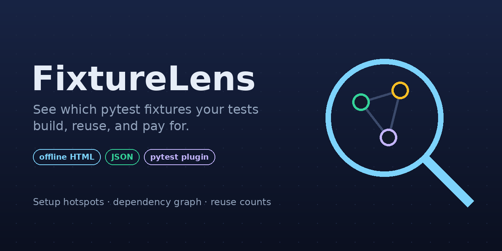
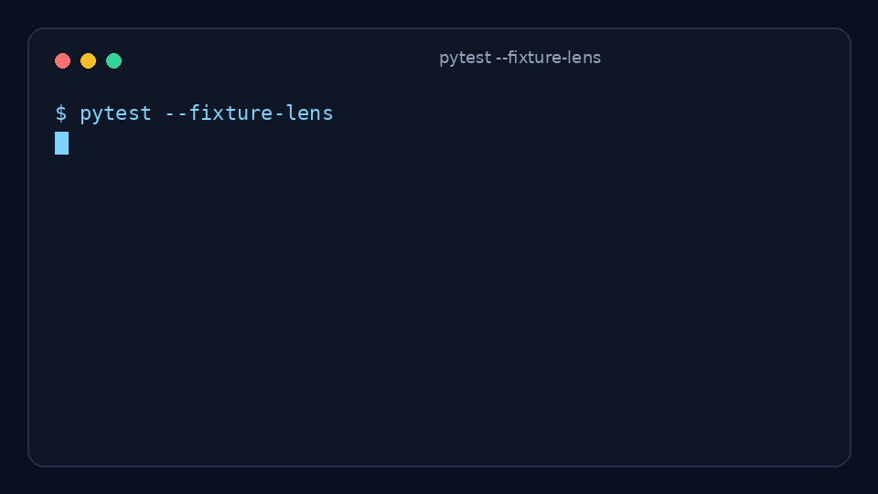
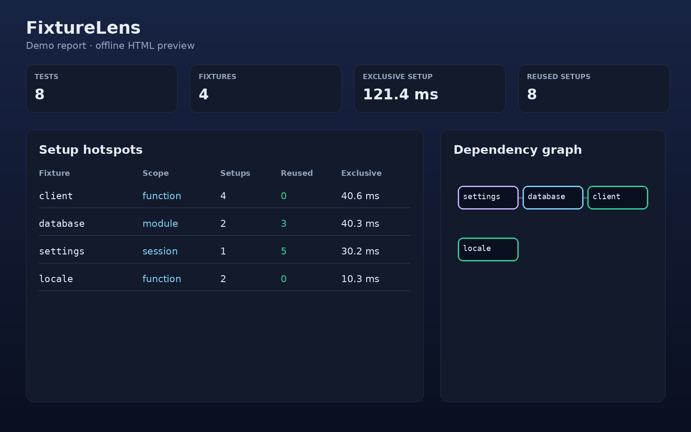

<p align="center">
  <a href="README.md">English</a> · <a href="README.fa.md"><b>فارسی</b></a>
</p>

<div align="center">
  
  <h1>FixtureLens</h1>
</div>

<div dir="rtl">

**ببینید تست‌هایتان واقعاً کدام fixtureها را می‌سازند، کدام‌ها را دوباره استفاده می‌کنند، و بابت کدام‌ها وقت می‌دهید.**

یک پلاگین اختیاری برای `pytest` که بعد از اجرای تست‌ها، گزارشی از **هزینهٔ راه‌اندازی fixtureها**، **میزان استفادهٔ مجدد** و **گراف وابستگی‌ها** می‌سازد؛ به‌صورت HTML آفلاین و JSON.

بدون اینترنت، بدون منابع خارجی، بدون حساب کاربری، بدون هوش مصنوعی.

> وضعیت: نسخهٔ آلفا. نام بسته `pytest-fixture-lens` در نظر گرفته شده اما هنوز روی PyPI منتشر نشده است.

</div>

<div align="center">
  <a href="https://pypi.org/project/pytest-fixture-lens/"></a>
  <a href="https://github.com/WMiliya/pytest-fixture-lens/actions/workflows/ci.yml"></a>
  <a href="LICENSE"></a>
  
  
</div>

---

<div dir="rtl">

## چه مشکلی را حل می‌کند؟

خیلی وقت‌ها کندی مجموعه‌تست‌ها به‌خاطر خودِ assertionها نیست. کندی از آن‌جایی می‌آید که **fixtureها** — اتصال دیتابیس، کلاینت API، فایل موقت، دادهٔ اولیه — بیش از آن‌چه فکر می‌کنید ساخته می‌شوند.

FixtureLens به این سؤال‌ها جواب می‌دهد:

- کدام fixture بیشترین زمان راه‌اندازی را می‌گیرد؟
- کدام fixture را تست‌های زیادی می‌خواهند، ولی فقط یک‌بار ساخته می‌شود؟
- کدام تست باعث ساخته‌شدن زنجیره‌ای غیرمنتظره از fixtureها شده؟
- آیا یک fixture با scope نشست (session)، اشتباهی در زنجیره‌ای با scope تابع (function) گیر افتاده؟

این ابزار جایگزین `pytest` نیست، پروفایلر کد برنامهٔ شما نیست و ابزار هوش مصنوعی هم نیست. فقط یک پلاگین کوچک و اختیاری است که راه‌اندازی fixtureها را **قابل دیدن** می‌کند.

## دمو

</div>

```bash
pytest examples/demo_project/tests --fixture-lens --fixture-lens-dir examples/demo_project
```

<div dir="rtl">

سپس فایل `examples/demo_project/report.html` را باز کنید.

</div>

<div align="center">
  
  <br><br>
  
</div>

<div dir="rtl">

## شروع سریع

نصب از PyPI:

</div>

```bash
pip install pytest-fixture-lens
```

<div dir="rtl">

یا نصب از روی مخزن:

</div>

```bash
python -m pip install -e .
```

<div dir="rtl">

نصب از PyPI بعد از اولین انتشار فعال می‌شود؛ راهنما در [docs/pypi.md](docs/pypi.md).

اجرای تست‌ها با پلاگین فعال:

</div>

```bash
pytest --fixture-lens
```

<div dir="rtl">

گزارش را باز کنید:

</div>

```text
.fixturelens/report.html
```

<div dir="rtl">

خروجی ماشین‌خوان:

</div>

```text
.fixturelens/report.json
```

<div dir="rtl">

پوشهٔ خروجی دلخواه:

</div>

```bash
pytest --fixture-lens --fixture-lens-dir build/fixturelens
```

<div dir="rtl">

## چه چیزی گیرتان می‌آید؟

| قابلیت | توضیح |
| --- | --- |
| نقاط داغ راه‌اندازی | fixtureها مرتب‌شده بر اساس زمان خالص راه‌اندازی |
| گراف وابستگی | گراف بین fixtureها، ساخته‌شده از آرگومان‌های آن‌ها |
| شمارش استفادهٔ مجدد | درخواست‌شده در برابر ساخته‌شده در برابر استفادهٔ مجدد |
| رویداد هر تست | کدام راه‌اندازی‌ها هنگام هر تست رخ داده |
| HTML آفلاین | گزارش مستقل، بدون شبکه و بدون منابع خارجی |
| خروجی JSON | گزارش ماشین‌خوان برای CI یا ابزارهای دیگر |
| رفتار امن هنگام خطا | حتی وقتی تست‌ها شکست بخورند، گزارش نوشته می‌شود |

## گزینه‌های خط فرمان

| گزینه | پیش‌فرض | معنا |
| --- | --- | --- |
| `--fixture-lens` | خاموش | فعال‌سازی گزارش |
| `--fixture-lens-dir DIR` | `.fixturelens` | محل نوشتن `report.html` و `report.json` |

نمونهٔ خلاصهٔ ترمینال:

</div>

```text
--------------- FixtureLens ---------------
8 tests · 4 fixtures · 121.7 ms exclusive setup · 8 reused setups
report: .fixturelens/report.html
```

<div dir="rtl">

## گزارش را چطور بخوانیم؟

### نقاط داغ

بر اساس **زمان خالص (exclusive)** مرتب شده است. زمان خالص، بازه‌های راه‌اندازی fixtureهای تودرتو را کم می‌کند تا هزینهٔ فرزند دوباره به حساب والد نوشته نشود.

### درخواست‌شده، ساخته‌شده، استفادهٔ مجدد

- **Requested**: تعداد تست‌هایی که مجموعهٔ fixture آن‌ها شامل این fixture است.
- **Setups**: تعداد رویدادهای راه‌اندازی مشاهده‌شده.
- **Reused**: حاصل `requested - setups`، با کف صفر.

مثال: fixtureای با scope نشست که ۲۰ تست آن را می‌خواهند و فقط یک‌بار ساخته می‌شود، عدد ۱۹ را برای استفادهٔ مجدد نشان می‌دهد.

fixtureهای پارامتری بر اساس تابع تجمیع می‌شوند و شمارهٔ پارامترها روی رویدادها نگه داشته می‌شود.

### گراف

روی هر گره بزنید تا scope، فایل منبع، وابستگی‌ها، شمار ساخت و زمان‌بندی را ببینید.

## چطور کار می‌کند؟

FixtureLens از هوک‌های pytest استفاده می‌کند:

- `pytest_runtest_protocol` و `pytest_runtest_setup` برای ثبت مجموعهٔ fixture هر تست
- `pytest_fixture_setup` برای اندازه‌گیری بازهٔ راه‌اندازی
- `pytest_runtest_logreport` برای ثبت نتیجهٔ تست‌ها
- `pytest_sessionfinish` برای نوشتن گزارش‌ها

جزئیات بیشتر در [docs/how-it-works.md](docs/how-it-works.md) و ساختار JSON در [docs/report-schema.md](docs/report-schema.md).

## محدودیت‌ها

این نسخه عمداً محدود نگه داشته شده است:

- فقط بازهٔ راه‌اندازی؛ زمان teardown اندازه‌گیری نمی‌شود.
- گراف ممکن است فراخوانی‌های پویای `request.getfixturevalue()` را نبیند.
- نمونه‌های پارامتری بر اساس تابع تجمیع می‌شوند.
- اجرای توزیع‌شده با `pytest-xdist` با پیام روشن رد می‌شود.
- زمان‌ها اندازه‌گیری یک اجرا هستند، نه بنچمارک پایدار آماری.
- گزارش شامل شناسهٔ تست‌ها، نام fixtureها و مسیر فایل‌هاست؛ پیش از انتشار عمومی بازبینی کنید.

## توسعه

</div>

```bash
python -m pip install -e ".[dev]"
ruff check .
ruff format --check .
pytest
```

<div dir="rtl">

اجرای دمو به‌عنوان تست دود:

</div>

```bash
pytest examples/demo_project/tests --fixture-lens --fixture-lens-dir examples/demo_project
```

<div dir="rtl">

بازتولید تصاویر README:

</div>

```bash
python scripts/make_assets.py
```

<div dir="rtl">

## نقشهٔ راه

مشارکت‌های خوب بعدی:

- اندازه‌گیری زمان teardown
- پشتیبانی از pytest-xdist
- ردیابی `getfixturevalue()` پویا
- خروجی CSV
- حالت بودجهٔ CI: شکست وقتی زمان راه‌اندازی از حد مشخصی بیشتر شد
- خط زمانی شبیه flamegraph برای هر تست

## مشارکت

فایل [CONTRIBUTING.md](CONTRIBUTING.md) را ببینید. تغییرهای کوچک و تست‌شده خوش‌آمدند. لطفاً رمز واقعی، نام تست‌های خصوصی یا دادهٔ سازمانی را در گزارش‌ها و issueها قرار ندهید.

## پشتیبانی و امنیت

- پشتیبانی: [SUPPORT.md](SUPPORT.md)
- امنیت: [SECURITY.md](SECURITY.md)
- منشور اخلاقی: [CODE_OF_CONDUCT.md](CODE_OF_CONDUCT.md)

## پروانه

MIT. فایل [LICENSE](LICENSE) را ببینید.

</div>
