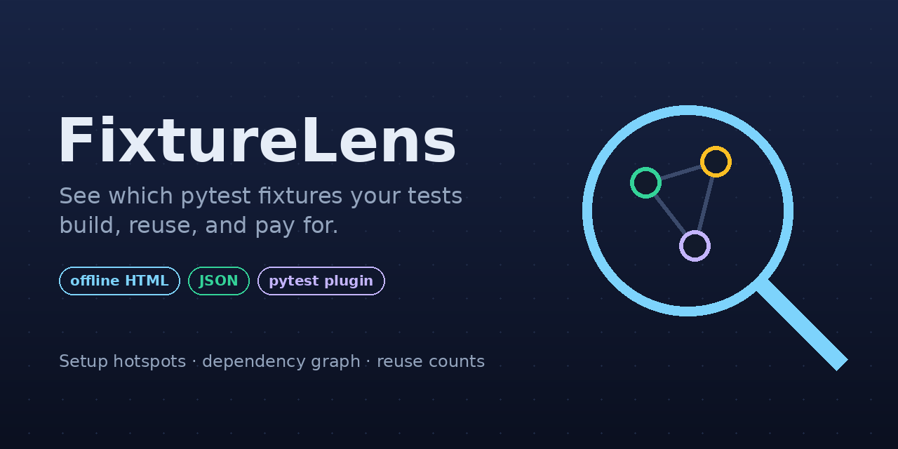
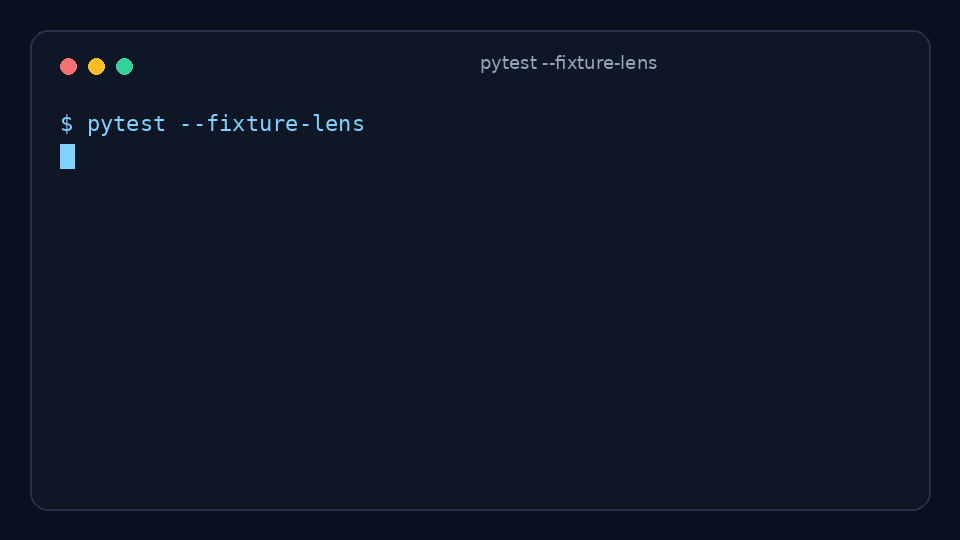
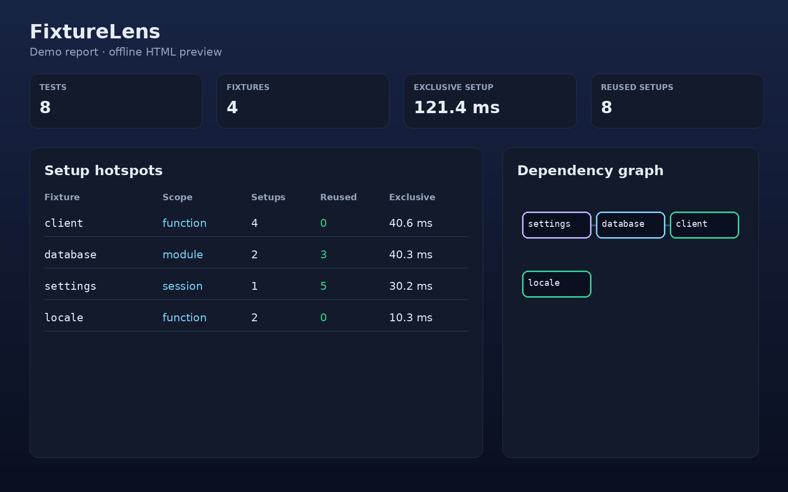

<p align="center">
  <a href="README.md"><b>English</b></a> · <a href="README.fa.md">فارسی</a>
</p>

<div align="center">
  
  <h1>FixtureLens</h1>
  <p><strong>See which pytest fixtures your tests actually build, reuse, and pay for.</strong></p>
  <p>Offline HTML + JSON reports for pytest fixture setup cost, reuse, and dependencies.</p>

  <p>
    <a href="https://github.com/WMiliya/pytest-fixture-lens/actions/workflows/ci.yml"></a>
    <a href="LICENSE"></a>
    
    
    <a href="https://github.com/astral-sh/ruff"></a>
    <a href="CONTRIBUTING.md"></a>
  </p>

  <p>
    <a href="#quickstart">Quickstart</a> ·
    <a href="#demo">Demo</a> ·
    <a href="#what-you-get">What you get</a> ·
    <a href="docs/how-it-works.md">How it works</a> ·
    <a href="docs/faq.md">FAQ</a> ·
    <a href="docs/publishing.md">Publishing</a>
  </p>
</div>

---

## What problem does it solve?

A slow pytest suite is often not slow because of assertions. It is slow because **fixtures** — database connections, API clients, temp files, seeded data — are built more often than you think.

FixtureLens answers questions like:

- Which fixtures cost the most setup time?
- Which fixtures are requested by many tests but set up only once?
- Which test triggered a surprising chain of fixture setup?
- Is a session-scoped fixture accidentally being pulled into a function-scoped chain?

It is **not** a replacement for pytest, a profiler for your application code, or an LLM tool. It is a small, opt-in pytest plugin that makes fixture setup visible.

## Demo

Run the demo:

```bash
pytest examples/demo_project/tests --fixture-lens --fixture-lens-dir examples/demo_project
```

Then open `examples/demo_project/report.html`.

<div align="center">
  
  <br><br>
  
</div>

## Quickstart

Install from a checkout:

```bash
python -m pip install -e .
```

Run your tests with the plugin enabled:

```bash
pytest --fixture-lens
```

Open the report:

```text
.fixturelens/report.html
```

Machine-readable output:

```text
.fixturelens/report.json
```

Custom output directory:

```bash
pytest --fixture-lens --fixture-lens-dir build/fixturelens
```

> Status: alpha MVP. The distribution name `pytest-fixture-lens` is planned, but not published to PyPI yet.

## What you get

| Feature | Description |
| --- | --- |
| Setup hotspots | Fixtures sorted by exclusive setup time. |
| Dependency graph | Fixture-to-fixture graph built from fixture arguments. |
| Reuse counts | Requested vs setups vs reused, per fixture function. |
| Per-test events | Which fixture setup spans happened during each test. |
| Offline HTML | Self-contained report: no network, no external assets. |
| JSON output | Machine-readable report for CI or custom tooling. |
| Safe failure behavior | Reports are written even when tests fail. |

## CLI options

| Option | Default | Meaning |
| --- | --- | --- |
| `--fixture-lens` | off | Enable the report. |
| `--fixture-lens-dir DIR` | `.fixturelens` | Where to write `report.html` and `report.json`. |

Example terminal summary:

```text
--------------- FixtureLens ---------------
8 tests · 4 fixtures · 121.7 ms exclusive setup · 8 reused setups
report: .fixturelens/report.html
```

## How to read the report

### Hotspots

Sorted by **exclusive setup time**. Exclusive time subtracts nested fixture setup spans so a parent fixture does not get charged again for the full cost of its children.

### Requested vs setups vs reused

- **Requested**: number of selected tests whose fixture closure includes this fixture.
- **Setups**: number of observed setup events for this fixture function.
- **Reused**: `requested - setups`, floored at zero.

A session fixture requested by 20 tests and set up once shows 19 reused setups.

Parametrized fixtures are aggregated by fixture function. Observed parameter indices are kept on setup events.

### Graph

Click a node to see scope, source, dependencies, setup counts, and timing.

## How it works

FixtureLens uses pytest hooks:

- `pytest_runtest_protocol` / `pytest_runtest_setup` to record each test's fixture closure.
- `pytest_fixture_setup` to measure fixture setup spans.
- `pytest_runtest_logreport` to record test outcomes.
- `pytest_sessionfinish` to write `report.html` and `report.json`.

See [docs/how-it-works.md](docs/how-it-works.md) for details and [docs/report-schema.md](docs/report-schema.md) for the JSON shape.

## Limitations

This MVP is intentionally narrow:

- Setup spans only; teardown time is not measured.
- The dependency graph may miss dynamic `request.getfixturevalue()` calls.
- Parametrized instances are aggregated by fixture function.
- `pytest-xdist` distributed runs are rejected with a clear error.
- Timings are wall-clock measurements from one run, not a statistically stable benchmark.
- Reports contain test node IDs, fixture names, and source paths. Review before sharing publicly.

## Development

```bash
python -m pip install -e ".[dev]"
ruff check .
ruff format --check .
pytest
```

Run the demo as a smoke test:

```bash
pytest examples/demo_project/tests --fixture-lens --fixture-lens-dir examples/demo_project
```

Regenerate README assets:

```bash
python scripts/make_assets.py
```

## Project layout

```text
src/fixturelens/       Plugin, report builder, HTML template
tests/                 pytester-based integration tests
examples/demo_project/ Small demo suite with session/module/function fixtures
docs/                  How it works, JSON schema, FAQ, publishing guide
assets/                Banner, logo, demo GIF, report preview
.github/               CI, issue templates, PR template, Dependabot
```

## Roadmap

Good next contributions:

- teardown timing,
- pytest-xdist support,
- dynamic `getfixturevalue()` tracking,
- CSV export,
- CI budget mode: fail when exclusive setup time exceeds a threshold,
- optional flamegraph-style timeline per test.

## Contributing

See [CONTRIBUTING.md](CONTRIBUTING.md). Small, tested changes are welcome. Please do not include real secrets, private test names, or proprietary fixture data in reports or issues.

## Support and security

- Support: [SUPPORT.md](SUPPORT.md)
- Security: [SECURITY.md](SECURITY.md)
- Code of conduct: [CODE_OF_CONDUCT.md](CODE_OF_CONDUCT.md)

## License

MIT. See [LICENSE](LICENSE).
